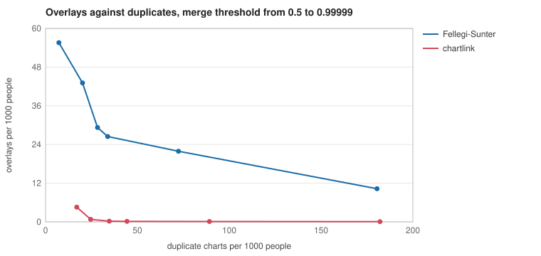

# chartlink

Link patient records from different hospitals, clinics, labs and pharmacies into one chart per person, without putting twins, fathers and sons, or two people named Nancy Brown into the same chart.

On synthetic populations of 20,000 people with realistic registration mistakes, plain Fellegi-Sunter (the textbook probabilistic matcher) put 29 people per 1000 on someone else's chart. chartlink put 0.22 per 1000 there, about 130 times fewer, while still finding 96.6% of the record pairs that belong together. After a review queue of about 24 charts per 1000 records, it ends with fewer split charts than Fellegi-Sunter too.

## The problem

The US has no national patient identifier. Each system that registers a patient makes its own record, from whatever the patient says and the desk types: ROBERT J SMITH at the hospital, BOB SMYTH at urgent care, the maiden name at the old clinic. A master patient index has to decide which of these are one person.

It can go wrong two ways, and they are not equally bad:

- **A duplicate** is one patient with two charts. Their history is split: a doctor misses an allergy recorded at the other clinic, a test is done twice.
- **An overlay** is two patients in one chart. One person's results, medications and allergies show up on the other's chart. It's the dangerous one, and it's slow and expensive to undo.

Exact matching on name and birth date makes almost no overlays and leaves 28% of people with a split chart. Probabilistic matching (Fellegi-Sunter) finds nearly everyone, and on real households it overlays twins, siblings, and fathers and sons with the same name. The reason is in its core assumption: fields are taken as independent evidence. Twins agree on last name, birthday, street, zip and home phone, and the model counts all five.

## The idea

Fellegi-Sunter with EM, plus three things. [DESIGN.md](DESIGN.md) has the long version.

1. **A household is one piece of evidence.** Street, zip and phone agreeing are what everyone in a household shares. Only the strongest of them counts. This alone takes overlays from 7.4 to 0.22 per 1000.
2. **Rare names count for more.** Agreeing on SMITH is weak, agreeing on KOVALENKO is strong. Exact name matches are weighed by how many records have that name.
3. **A guard on every merge.** Before two charts join, every pair of records across them is checked for a hard conflict: twins (same birthday, first names more than two edits apart even through nicknames), a father and son (JR against SR, or birth years a generation apart on different days), or two different SSNs. One conflict anywhere stops the merge, which stops chains: A matches B, B matches C, but A and C are twins.

Pairs that are likely but not certain, and pairs the guard stopped, go to a review queue, one entry per pair of charts. Someone who goes by their middle name looks exactly like a twin, so a person decides.

It runs as a batch over a whole set of records or as an index that links each record as it arrives.

## Results

Five synthetic populations of 20,000 people, about 43,000 records each, from five sources with their own error rates. Means over the five. Full tables are in [results/](results/quality.md).

| matcher | overlays per 1000 people | duplicates per 1000 people | pairwise precision | pairwise recall | review queue |
|---|---:|---:|---:|---:|---:|
| exact first, last, DOB | 0.05 | 354.2 | 0.9999 | 0.6040 | 0 |
| Fellegi-Sunter with EM | 29.27 | 28.3 | 0.9119 | 0.9766 | 957 |
| **chartlink** | **0.22** | 34.7 | 0.9997 | 0.9660 | 1041 |

chartlink leaves a few more charts split than Fellegi-Sunter (34.7 against 28.3 per 1000) in exchange for 130 times fewer overlays. A reviewer who is always right, working through each matcher's queue, brings chartlink to 7.1 duplicates per 1000 and Fellegi-Sunter to 7.9. The overlays don't change, since the reviewer only merges.

The hard cases:

| matcher | twin pairs merged | Jr/Sr pairs merged | married, split | moved, split |
|---|---:|---:|---:|---:|
| exact first, last, DOB | 0.0% | 0.0% | 43.3% | 28.4% |
| Fellegi-Sunter with EM | 65.6% | 59.7% | 6.3% | 8.5% |
| **chartlink** | **1.5%** | **0.2%** | 7.0% | 7.5% |

People who go by their middle name are the cost of the guard: they look like twins, so 33% of them are split before review and 1.9% after.

One threshold can flatter a matcher, so here is the whole range. Each point is a merge threshold from 0.5 to 0.99999. At every setting, chartlink makes fewer overlays at fewer or about the same duplicates.



**What each piece is worth** ([ablation](results/ablation.md)):

| variant | overlays per 1000 | duplicates per 1000 | twin pairs merged |
|---|---:|---:|---:|
| chartlink | 0.22 | 34.7 | 1.5% |
| household fields counted separately | 7.39 | 33.7 | 2.4% |
| no chart guard | 7.43 | 25.8 | 42.7% |
| names not weighted by rarity | 0.16 | 38.7 | 1.4% |

Weighing names by rarity is a trade, not a pure win: it finds more people and lets a few more wrong ones through.

**Blocking** finds 99.13% of true pairs with about 5.7 candidate pairs per record ([blocking](results/blocking.md)). Pairs it misses can never be linked.

**Cost.** Batch linking of 43,000 records takes 0.78 s. Fed one record at a time into an index on one core of an Apple M4:

| records in the stream | Add p50 | Add p99 | records per second | memory | overlays per 1000 | duplicates per 1000 |
|---:|---:|---:|---:|---:|---:|---:|
| 43,176 | 6.1 µs | 26 µs | 127,000 | 25 MB | 0.50 | 31.1 |
| 215,898 | 9.8 µs | 60 µs | 73,000 | 113 MB | 0.37 | 36.5 |
| 1,079,349 | 24.5 µs | 178 µs | 26,000 | 533 MB | 0.49 | 46.3 |

At a million records more blocks pass the 200-record cap and are skipped, so duplicates rise.

## Usage

Link a CSV of records into charts:

```
go run ./cmd/chartlink export -people 2000 > records.csv
go run ./cmd/chartlink link -review review.csv < records.csv > charts.csv
```

```
4291 records, 2056 charts, 136 pairs for review
```

The input needs `first`, `last` and `dob` (YYYY-MM-DD) columns. It can also have `id`, `source`, `middle`, `suffix`, `sex`, `phone`, `street`, `zip` and `ssn4`. The output has one row per record with the chart it belongs to, named after one of its records. `link` fits its model on the records it is given, so give it a few thousand at least.

Run the experiments and write every table and chart:

```
go run ./cmd/chartlink all -out results
```

The commands one at a time are `quality`, `ablate`, `sweep`, `blocking` and `bench`. `all` takes about a minute on an M4.

As a library, linking records as they arrive:

```go
ix := match.NewIndex(match.Fit(existing, match.DefaultConfig()), match.DefaultConfig())
id, review := ix.Add(rec)
chart := ix.Charts()[id]
```

## Running the tests

```
go test -race ./...
go test -run XXX -bench . -benchtime 3x ./match
```

## Layout

```
record/        the record, name cleaning, Jaro-Winkler, Soundex, nicknames, CSV
synth/         a synthetic population and the records five sources keep about it
match/         blocking, Fellegi-Sunter with EM, the guard, batch linking, the index
baseline/      exact first name, last name and birth date
score/         overlays, duplicates, pairwise precision and recall, hard cases
lab/           the experiments, and a reviewer who works the queue
cmd/chartlink  the command line
results/       what `chartlink all` wrote
```

## License

MIT
